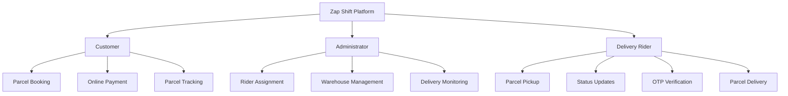
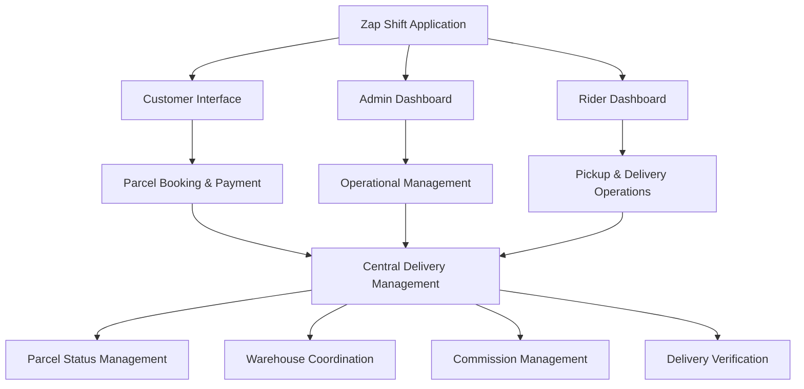
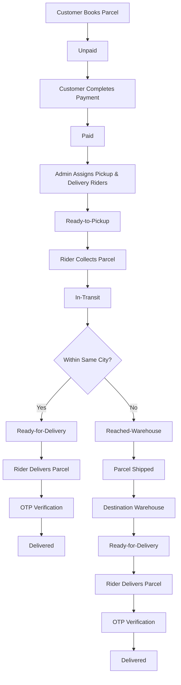

# 🚀 Zap Shift — Smart Parcel Management & Delivery Platform

  
  
  
  

  <b>Deliver Smarter. Track Faster. Manage Better.</b>

  A modern, role-based parcel management and delivery platform designed to streamline logistics operations, automate delivery workflows, simplify parcel bookings, and provide transparent tracking experiences.

  <a href="https://zap-shift-c1048.web.app/"><b>🌐 Live Application</b></a> •
  <a href="#-core-features"><b>✨ Features</b></a> •
  <a href="#-delivery-workflow"><b>🚚 Workflow</b></a> •
  <a href="#-system-architecture"><b>🏗️ Architecture</b></a>

---

## 📌 Table of Contents

- [🌟 Project Overview](#-project-overview)
- [🎯 Project Objectives](#-project-objectives)
- [✨ Core Features](#-core-features)
- [👥 User Roles & Responsibilities](#-user-roles--responsibilities)
- [🏗️ System Architecture](#️-system-architecture)
- [🚚 Delivery Workflow](#-delivery-workflow)
- [💰 Pricing Structure](#-pricing-structure)
- [💵 Rider Commission System](#-rider-commission-system)
- [🔐 Security & Access Control](#-security--access-control)
- [📊 Key System Modules](#-key-system-modules)
- [🛠️ Technology & Development](#️-technology--development)
- [🌍 Service Coverage](#-service-coverage)
- [🚀 Live Deployment](#-live-deployment)
- [💡 Future Enhancements](#-future-enhancements)

---

## 🌟 Project Overview

**Zap Shift** is a comprehensive parcel management and delivery solution built to simplify the logistics ecosystem through a centralized digital platform.

The platform connects customers, administrators, and delivery riders through a structured workflow, enabling efficient parcel booking, automated pricing, payment processing, rider assignments, shipment coordination, and delivery tracking.

Rather than relying on disconnected manual operations, Zap Shift organizes the entire parcel delivery lifecycle into a streamlined system.

### What Makes Zap Shift Special?

- 📦 Simplified parcel booking and management.
- 💳 Integrated delivery payment workflow.
- 📍 Organized parcel status tracking.
- 👨‍💼 Dedicated administrative management.
- 🛵 Structured pickup and delivery assignments.
- 🔐 OTP-based delivery confirmation.
- 💰 Transparent rider commission distribution.
- 🏢 Warehouse-based inter-district logistics.

**The goal:** Build a reliable and scalable digital logistics experience that connects every stage of parcel delivery.

---

## 🎯 Project Objectives

| Objective | Description |
|---|---|
| Digital Transformation | Replace manual parcel management with organized digital workflows. |
| Operational Efficiency | Simplify parcel collection, routing, and delivery assignments. |
| Transparent Pricing | Calculate delivery charges based on parcel type, weight, and destination. |
| Secure Delivery | Introduce OTP-based verification for delivery confirmation. |
| Role Management | Provide dedicated functionalities for customers, administrators, and riders. |
| Nationwide Logistics | Support structured delivery operations across 64 districts. |
| Commission Management | Maintain a transparent rider earning distribution system. |

---

## ✨ Core Features

### 📦 1. Smart Parcel Management
- Create and book delivery requests.
- Select parcel types and destinations.
- Manage parcel information and delivery details.
- Monitor parcel status throughout the delivery lifecycle.

### 💳 2. Automated Pricing & Payments
- Dynamic delivery charge calculation.
- Weight-based pricing for non-document parcels.
- Different rates for intra-city and inter-district deliveries.
- Online payment workflow.

### 📍 3. Parcel Tracking
- Track parcel progress through different delivery stages.
- Monitor pickup, warehouse, shipment, and delivery statuses.
- Maintain an organized delivery lifecycle.

### 👨‍💼 4. Administrative Dashboard
- Manage customers and delivery operations.
- Assign pickup and delivery riders.
- Coordinate warehouse operations.
- Monitor parcel movement and delivery progress.

### 🛵 5. Rider Management
- Receive assigned pickup and delivery tasks.
- Update parcel delivery statuses.
- Confirm successful deliveries using OTP.
- Handle warehouse handoffs.
- Track delivery-based earnings.

### 🔐 6. Secure Delivery Verification
- OTP-based delivery confirmation.
- Structured handoff and delivery procedures.
- Role-based access to operational features.

### 🌍 7. Nationwide Delivery Support
- Support for delivery operations across Bangladesh.
- Within-city and outside-city delivery workflows.
- Warehouse-based inter-district parcel transportation.

---

## 👥 User Roles & Responsibilities

Zap Shift follows a three-role operational structure.

| Role | Key Responsibilities | Benefits |
|---|---|---|
| **Customer / User** | Book parcels, pay delivery charges, track shipments, review services. | Convenient booking, delivery visibility, feedback opportunities. |
| **Administrator** | Assign riders, manage routing, oversee warehouses, monitor operations. | Centralized control and operational oversight. |
| **Delivery Rider** | Collect parcels, deliver shipments, update statuses, verify OTPs, transfer parcels to warehouses. | Delivery-based commission and task management. |

### 🔄 Role-Based Operational Structure

---

## 🏗️ System Architecture

The platform is organized around three primary operational layers:

This structure separates customer-facing operations from administrative controls and rider activities, creating a more organized delivery management experience.

---

## 🚚 Delivery Workflow

The delivery process follows a structured lifecycle depending on whether the destination is within the same city or outside the city.

### Complete Parcel Delivery Lifecycle

### 📋 Parcel Status Lifecycle

| Status | Description |
|---|---|
| `Unpaid` | Parcel booking is created, but payment is pending. |
| `Paid` | Delivery payment has been completed. |
| `Ready-to-Pickup` | A rider has been assigned for parcel collection. |
| `In-Transit` | The parcel has been collected and is moving through the delivery network. |
| `Reached-Warehouse` | The parcel has arrived at a warehouse. |
| `Shipped` | The parcel has been dispatched toward its destination. |
| `Ready-for-Delivery` | The parcel is ready for final delivery. |
| `Delivered` | Delivery has been successfully completed. |

---

## 💰 Pricing Structure

Zap Shift uses a destination-based and weight-based pricing model.

| Parcel Type | Weight | Within City | Outside City / District |
|---|---|---:|---:|
| **Document** | Any | ৳60 | ৳80 |
| **Non-Document** | Up to 3 kg | ৳110 | ৳150 |
| **Non-Document** | Above 3 kg | +৳40/kg | +৳40/kg + ৳40 extra |

**Pricing Highlights:**
- Different pricing for documents and non-document parcels.
- Weight-based additional charges.
- Separate rates for local and inter-district deliveries.
- Transparent delivery charge calculation.

---

## 💵 Rider Commission System

Zap Shift incorporates a delivery-based commission structure to provide transparent earning opportunities for delivery riders.

| Delivery Category | Rider Commission |
|---|---:|
| Same-city delivery | 80% |
| Outside-city delivery | 60% |

The commission model connects rider earnings directly to successful delivery operations.

---

## 🔐 Security & Access Control

A reliable logistics platform needs more than parcel tracking. It also requires structured access and delivery verification.

Zap Shift incorporates:

- **Role-Based Access:** Separate operational responsibilities for customers, administrators, and riders.
- **OTP Verification:** Additional verification during parcel delivery.
- **Payment Workflow:** Payment status management before delivery operations.
- **Controlled Operations:** Dedicated administrative responsibilities for rider assignments and warehouse coordination.
- **Status-Based Tracking:** Structured parcel progression through predefined delivery stages.

---

## 📊 Key System Modules

| Module | Purpose |
|---|---|
| Authentication | User authentication and account access. |
| Parcel Booking | Create and manage parcel delivery requests. |
| Pricing Engine | Determine charges based on delivery conditions. |
| Payment Management | Handle parcel delivery payment workflows. |
| Tracking System | Monitor parcel status and delivery progress. |
| Rider Assignment | Coordinate pickup and delivery responsibilities. |
| Warehouse Management | Manage inter-district parcel handoffs. |
| Commission Management | Organize rider delivery-based earnings. |
| Review & Feedback | Allow customers to share service experiences. |

---

## 🛠️ Technology & Development

The project is designed around modern web application development principles.

**Development areas:**
- Component-based frontend architecture.
- Dynamic user interfaces.
- API-driven application functionality.
- Database-backed parcel management.
- Authentication and role-based authorization.
- Payment workflow integration.
- Responsive web application development.
- Deployment and production hosting.

---

## 🌍 Service Coverage

<b>🇧🇩 Nationwide Delivery Coverage — 64 Districts</b>

Zap Shift is designed to support parcel delivery operations across Bangladesh's 64 districts.

**Division-wise coverage:**

| Division | Districts |
|---|---:|
| Dhaka | 13 |
| Chattogram | 11 |
| Rajshahi | 8 |
| Khulna | 10 |
| Barishal | 6 |
| Sylhet | 4 |
| Rangpur | 8 |
| Mymensingh | 4 |
| **Total** | **64** |

---

## 🚀 Live Deployment

  

**Live Website:** https://zap-shift-c1048.web.app/

Explore the platform to experience its parcel management interface and delivery workflow.

---

## 💡 Future Enhancements

Potential improvements to make the platform even more powerful:

- [ ] Real-time GPS-based rider tracking.
- [ ] Interactive shipment route visualization.
- [ ] Automated SMS and email notifications.
- [ ] Advanced delivery analytics and reporting.
- [ ] AI-powered delivery route optimization.
- [ ] Predictive delivery time estimation.
- [ ] Advanced warehouse inventory management.
- [ ] Customer support chatbot.
- [ ] Advanced operational performance dashboard.
- [ ] Mobile application for delivery riders.

---

## 🧠 Engineering Highlights

This project demonstrates practical implementation concepts in modern logistics software:

- Multi-role application design.
- End-to-end business workflow management.
- Conditional delivery routing.
- Dynamic pricing logic.
- Payment lifecycle management.
- Secure delivery confirmation.
- Warehouse-based logistics coordination.
- Commission-based business logic.
- Scalable feature and module organization.

---

## 👨‍💻 Developer

**Mohammad Arman**  
Full Stack Developer | MERN Stack | React.js

Building modern web applications, intelligent digital solutions, and scalable software experiences.

  
  

---

  <b>⚡ Zap Shift — Moving Parcels. Connecting People. Simplifying Logistics.</b>

  Made with ❤️ and a passion for building impactful digital solutions.

